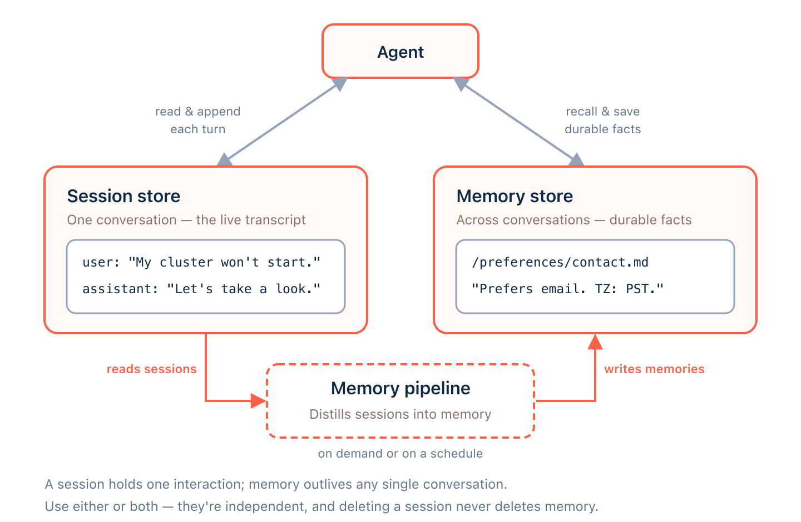

# Agentic Memory

Give AI agents managed **sessions** (short-term state for one conversation) and **memory** (durable facts recalled across conversations), and use **memory pipelines** to distill one into the other. Both stores are fully managed and backed by Lakebase, and they work with agents built on any framework.

## Labs

| Lab | What You'll Learn |
|-----|-------------------|
| `Agent_Memory` | Session stores and conversation replay; memory stores with `put` / `list` / `search`; memory pipelines that distill and merge entries; store permissions and `actor_id` scoping; the legacy self-managed Lakebase pattern for reference |

## Prerequisites

- **Agent Memory Sessions preview (Beta)**: a workspace admin must enable **Agent Memory Sessions** on the workspace **Previews** page.
- **`databricks-agentbricks` ≥ 0.8.0**: installed by the notebook (Python 3.10+).
- **Distillation model access (Part 3)**: permission to query the memory pipeline model through AI Gateway. The notebook defaults to `system.ai.gpt-5-4-mini`. The model must support structured output; some newer Anthropic models reject it, and the pipeline run fails.
- **Store quota**: a workspace holds up to 50 memory stores. The lab creates one memory store and one session store per participant (`lab-<user>-memory`, `lab-<user>-sessions`), so run the cleanup cell afterwards.
- Complete **`00_Setup_Lakebase_Project`**, which provides the shared `_setup` helpers.
- **Lab Console (optional)**: the notebook grants the app's service principal WRITE on your two stores so the **Agent Memory** page can use them.

## Key Concepts

- **Agent sessions**: store the state of one interaction, usually the conversation history. A session store holds sessions, and each session holds ordered, immutable session items. The agent reads the session at the start of a turn and appends to it as the interaction runs.
- **Agent memory**: stores durable facts, preferences, and decisions that the agent recalls in later, separate conversations with semantic search. Each entry is identified by `actor_id` (whose memory it is), an optional `session_id`, and a filesystem-like `path`.
- **Memory pipelines**: read conversations from a session store, distill durable facts, and write them to a memory store. Runs can be manual, scheduled (about every 24 hours), or always-on. Each run also merges overlapping entries and splits oversized ones, including entries your agent wrote directly.
- **The store is the security boundary**: `actor_id` separates memories but is not access control. Access is granted per store (READ or WRITE) to users or service principals.
- **Independent stores**: deleting a session, or a whole session store, never deletes memory already saved.

## Documentation

- [Agent memory and sessions](https://docs.databricks.com/aws/en/generative-ai/agent-framework/stateful-agents)
- [Agent sessions](https://docs.databricks.com/aws/en/agents/agent-memory/managed-sessions)
- [Agent memory](https://docs.databricks.com/aws/en/agents/agent-memory/managed-memory)
- [Agent memory pipelines](https://docs.databricks.com/aws/en/agents/agent-memory/memory-pipelines)
- [Manage store permissions](https://docs.databricks.com/aws/en/agents/agent-memory/store-permissions)
- [Tutorial: Add sessions and memory to an existing agent](https://docs.databricks.com/aws/en/agents/agent-memory/existing-agent-tutorial)

## Framework Integrations

`databricks-agentbricks` includes adapters for the OpenAI Agents SDK and LangGraph:

| Framework | Sessions | Memory |
|-----------|----------|--------|
| OpenAI Agents SDK | `databricks_agentkit.openai.session_store(...)` | `databricks_agentkit.openai.memory_tools(user_id, store=...)` |
| LangGraph | `databricks_agentkit.langgraph.checkpointer(store=...)` | `databricks_agentkit.langgraph.memory_tools(user_id, store=...)` |

The `memory_tools` adapters give an agent four tools: `recall`, `remember`, `forget`, and `list_memories`. A LangGraph checkpointer stores serialized checkpoints that a memory pipeline can't distill, so give a LangGraph agent a separate transcript session store if it also uses a pipeline.
